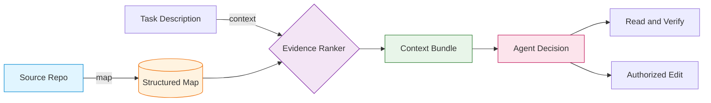
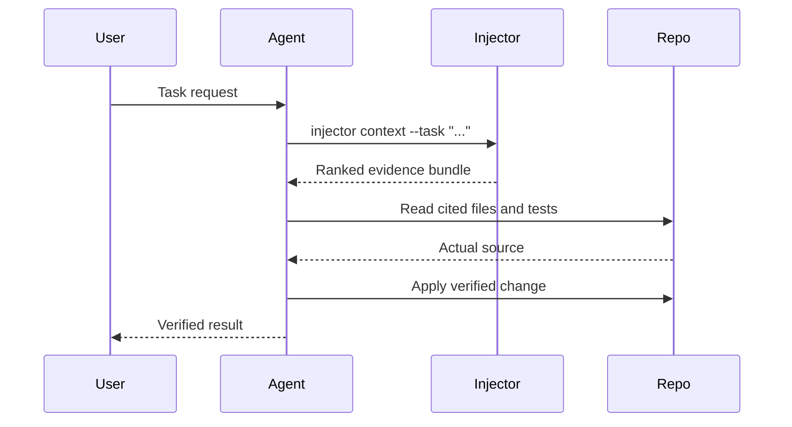

<div align="center">

# ⚡ Injector Engineering

### *Evidence before decisions.*

**A local-first CLI that connects code evidence before your agent decides.**

Caveman saves tokens in what an agent says.<br/>
**Injector connects code evidence before an agent decides.**

<br/>

[](LICENSE)
[](https://nodejs.org)
[](package.json)
[](https://github.com/shaonkabir8/injector-engineering)
[](https://github.com/shaonkabir8/injector-engineering)

<br/>

[**🚀 Quick Start**](#quick-start-) · [**📖 Commands**](#commands-) · [**🤖 Agent Skill**](#agent-workflow-) · [**🔐 Security**](#security-and-privacy-) · [**❓ FAQ**](#faq-)

<br/>

**🔒 No model API · 🌐 No network calls · ✏️ No source edits · 📦 No runtime dependencies**

</div>

***

## Table of Contents 📖

- [Why Injector](#why-injector-)
- [How It Works](#how-it-works-)
- [Quick Start](#quick-start-)
- [Commands](#commands-)
- [What It Indexes](#what-it-indexes-)
- [Agent Workflow](#agent-workflow-)
- [Architecture](#architecture-)
- [Security and Privacy](#security-and-privacy-)
- [FAQ](#faq-)
- [Development](#development-)
- [License](#license-)

***

## Why Injector 🎯

Coding agents hallucinate when they lack evidence. They guess at file layouts, invent symbol names, and edit the wrong module. Injector fixes this by delivering deterministic, cited, task-focused evidence before the agent decides.

| Problem | Injector's Answer |
|---|---|
| Agent guesses at code structure | Structured map of files, symbols, imports, tests |
| Hidden context buried in deep paths | Ranked candidate files per task |
| Repeated token waste re-reading trees | Cache outside the repo, reused across runs |
| Privacy risk with cloud context APIs | 100% local, zero network, no model calls |
| Wrong module edited | Related tests surfaced with the source |

***

## How It Works 🔍

```text
┌────────────────┐     ┌───────────────────┐     ┌──────────────────┐
│  Source Repo   │ ──► │  injector map .   │ ──► │  Structured Map  │
│  (local files) │     │  (lexical scan)   │     │  (cache/JSON)    │
└────────────────┘     └───────────────────┘     └────────┬─────────┘
                                                          │
                                                          ▼
┌────────────────┐     ┌───────────────────┐     ┌──────────────────┐
│  Agent Decides │ ◄── │ injector context  │ ◄── │  Task Description│
│  and Verifies  │     │  --task "..."     │     │  + Ranked Bundle │
└────────────────┘     └───────────────────┘     └──────────────────┘
```



Ranking is deterministic word overlap, not semantic search, and not a diagnosis. Always read the cited files and tests before choosing an implementation.

***

## Quick Start 🚀

Requires Node.js 18 or later.

### Install globally

```bash
git clone https://github.com/shaonkabir8/injector-engineering.git
cd injector-engineering
npm install -g .
```

### Or run directly, no install

```bash
node /path/to/injector-engineering/bin/injector.js <command>
```

### Use it in your repo

```bash
cd /path/to/your/repository

# 1. Build the map
injector map .

# 2. Ask for task-focused context
injector context . --task "session expiry validation"
```

`injector map` writes its cache outside the repository, under your user cache directory. Override with `INJECTOR_CACHE_HOME`. Use `--out <file>` to export a portable map. That file contains repository paths and symbol metadata, not source text.

***

## Commands 🛠

```text
injector map     [directory] [--out <file>] [--json]
injector context [directory] --task <description> [--map <file>] [--limit <count>]
injector --help
```

Both `map` and `context` print JSON. The context bundle contains:

- Ranked candidate files
- Matching symbols
- Import statements
- Related tests
- Dependency edges

***

## What It Indexes 📦

| Language | Extensions |
|---|---|
| JavaScript | `.js` `.cjs` `.mjs` `.jsx` |
| TypeScript | `.ts` `.cts` `.mts` `.tsx` |
| Python | `.py` |

Skipped automatically:

- Generated directories
- Dependency directories such as `node_modules` and `vendor`
- VCS metadata such as `.git` and `.hg`
- Files larger than 1 MiB, counted in the map summary

Symbol and test relationships are lightweight lexical hints, not a full language parser.

***

## Agent Workflow 🤖

Install or copy [`skills/injector/SKILL.md`](skills/injector/SKILL.md) into your coding agent's skill directory.

Activation triggers: `Injector Required` and `Injection Required`.

The contract:

1. Retrieve task-focused evidence before repository engineering decisions
2. Inspect the actual source and tests
3. Only then apply authorized changes



***

## Architecture 🏗

```text
injector-engineering/
├── bin/
│   └── injector.js          # CLI entrypoint
├── skills/
│   └── injector/
│       └── SKILL.md         # Agent skill contract
├── src/                     # Core scanner, ranker, cache
├── test/                    # Test suite
├── package.json
└── LICENSE
```

Design principles:

- Zero runtime dependencies: pure Node.js standard library
- Zero network code: never invokes model providers
- Cache outside the repo: keeps your working tree clean
- Deterministic ranking: reproducible evidence, no hidden state

***

## Security and Privacy 🔐

| Guarantee | Detail |
|---|---|
| No network | The CLI contains no network code and does not invoke model providers. |
| Local-only reads | Reads supported source files locally and stores only relative paths, symbol names, import strings, hashes, sizes, and relationships. |
| Out-of-repo cache | Default cache lives outside the repository. A manually exported map can reveal internal path and symbol names, so review before sharing. |
| No source edits | Never modifies application source. `--out` writes only the map file you specify. |

***

## FAQ ❓

<details>
<summary><strong>Is this semantic search?</strong></summary>

No. Ranking uses deterministic word overlap. It is a fast, reproducible filter, and you still read the cited code.

</details>

<details>
<summary><strong>Does it call an LLM?</strong></summary>

Never. Injector has no network code and no model integration.

</details>

<details>
<summary><strong>Where does the cache live?</strong></summary>

Under your OS user cache directory. Override with `INJECTOR_CACHE_HOME`, or export a portable map with `--out <file>`.

</details>

<details>
<summary><strong>Does it modify my source?</strong></summary>

No. `map` and `context` only read. `--out` writes only the map file you specify.

</details>

<details>
<summary><strong>Which languages are supported?</strong></summary>

JavaScript (`.js`, `.cjs`, `.mjs`, `.jsx`), TypeScript (`.ts`, `.cts`, `.mts`, `.tsx`), and Python (`.py`).

</details>

***

## Development 🧑💻

```bash
npm test
```

- No third-party runtime dependencies
- MIT licensed
- Node.js 18 and later

Contributions welcome. Please open an issue before large PRs.

***

## License 📄

Released under the [MIT License](LICENSE).

***

<div align="center">

**⚡ Injector Engineering** — *evidence before decisions.*

`#coding-agents` `#local-first` `#cli` `#code-context` `#ai-tools` `#developer-tools` `#static-analysis` `#zero-dependencies` `#privacy-first` `#typescript` `#python` `#nodejs`

<br/>

**Built for agents that read before they write.**

</div>
